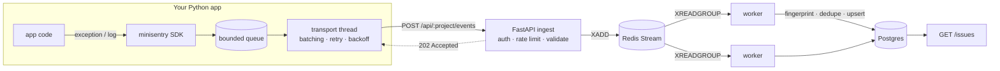

# minisentry

A small error-tracking system in Python, built to learn how tools like
[Sentry](https://sentry.io) work under the hood: an **SDK** that captures
exceptions inside an app, and an **ingest pipeline** that receives them,
groups duplicates into issues, and stores them.

```
$ python examples/trigger_errors.py
flushed: True
   2x  payment provider slow: 4100 ms
  10x  KeyError: 9                                   __main__ in load_order
   3x  ValueError: could not convert string to float: '1.2.3' __main__ in parse_price
```

15 errors in, 3 issues out: ten `KeyError`s with different ids are one bug,
and two log messages that differ only in a number are one issue.

---

## Architecture



The hot path (`POST /events`) only authenticates, rate-limits, validates and
enqueues. Grouping and database writes happen in workers, so latency stays
flat when an app suddenly sends 100x its normal error volume.

## What's inside

**SDK** (`src/minisentry`, stdlib only, zero dependencies)

- Captures exceptions with full stack traces, source context lines,
  chained causes (`raise ... from ...`) and an `in_app` flag per frame
- Breadcrumbs (what happened before the error) in a bounded ring buffer
- Integrations: uncaught exceptions (`sys.excepthook`, `threading.excepthook`),
  `logging` (INFO -> breadcrumb, ERROR -> event), ASGI middleware for FastAPI/Starlette
- Client-side scrubbing of passwords, tokens, cookies and auth headers
- `before_send` hook, `sample_rate`, custom fingerprints, tags, extra
- Background transport: non-blocking `submit`, opportunistic batching,
  exponential backoff with jitter, respects `429 Retry-After`, optional token-bucket rate limit
- Never blocks or crashes the host app (a full queue drops and counts, it never waits)

**Ingest service** (`src/minisentry_server`)

- FastAPI endpoint with per-project keys and per-project rate limiting (429 + `Retry-After`)
- Per-event validation: one malformed event doesn't reject the whole batch
- Redis Streams with consumer groups, acks, and `XAUTOCLAIM` for messages held by dead workers
- Grouping: SHA-256 over exception type + in-app `module.function` frames
  (line numbers and messages left out on purpose)
- Idempotent at-least-once processing: LRU cache + `UNIQUE(event_id)`
- Atomic, pre-aggregated, deadlock-safe upserts (`INSERT ... ON CONFLICT DO UPDATE`)

Why each choice was made, and what it costs: **[docs/design-decisions.md](docs/design-decisions.md)**.

## Data structures and algorithms

| Where | Structure | Cost | Why |
|---|---|---|---|
| Breadcrumbs | ring buffer (`deque(maxlen)`) | O(1) append | memory stays bounded forever |
| Rate limiting (SDK + API) | token bucket, lazily refilled | O(1) per call | allows bursts, caps the average, no timer thread |
| Retry scheduling | min-heap by due time | O(log n) push, O(1) peek | the sender knows exactly how long to sleep |
| Duplicate detection | LRU cache, hand-written: hash map + doubly linked list | O(1) get/put | catches SDK retries without a DB query |
| Grouping | normalized frames -> SHA-256; regex normalization of ids | O(frames) | same bug -> same issue across ids, lines, recursion depth |
| Issue counting | batch pre-aggregation + sorted upserts | 1 write per issue per batch | no lost updates, no deadlocks between workers |

## Quick start

**Without Docker** (API + worker in one process, SQLite):

```bash
python -m venv .venv && source .venv/bin/activate      # Windows: .venv\Scripts\activate
pip install -e ".[server,dev]"
python -m minisentry_server.dev                        # http://127.0.0.1:8000
python examples/trigger_errors.py                      # in a second terminal
```

**Full stack** (API, workers, Redis, Postgres):

```bash
cp .env.example .env                   # then replace each change-me with: openssl rand -hex 32
docker compose up --build              # add --scale worker=3 for more workers
MINISENTRY_DSN="http://<key from PROJECT_KEYS>@127.0.0.1:8000/1" python examples/trigger_errors.py
```

Only the API port is published; Postgres and Redis stay on the internal Docker network,
and Redis requires a password.

**Use the SDK in your own app:**

```python
import minisentry

minisentry.init("http://dev-public-key@127.0.0.1:8000/1", release="shop@1.2.0")

try:
    checkout(cart)
except PaymentError:
    minisentry.capture_exception(tags={"provider": "stripe"})

# FastAPI
from minisentry.integrations.asgi import MiniSentryMiddleware
app.add_middleware(MiniSentryMiddleware)
```

A demo FastAPI app with bugs on purpose is in [`examples/demo_app.py`](examples/demo_app.py).

## Dashboard

Open `http://127.0.0.1:8000/dashboard` and enter the project id and key. It shows
issue and event totals, events per minute for the last hour, the top issues, and a
detail panel per issue (stack trace with source, request, breadcrumbs, tags,
scrubbed extra data). It refreshes every 5 seconds. `./demo.sh` prints a link that
connects straight away.

The page is static HTML with no build step and no external scripts; it calls the
same authenticated API as any other client.

## API

All `/api` endpoints need the `X-Minisentry-Key` header.

| Method | Path | |
|---|---|---|
| `POST` | `/api/{project}/events` | `{"events": [...]}`, up to 100 per request -> `202 {"accepted": n, "rejected": [...]}` |
| `GET` | `/api/{project}/issues` | issues by last seen |
| `GET` | `/api/{project}/issues/{id}` | one issue |
| `GET` | `/api/{project}/issues/{id}/events` | latest events of an issue |
| `GET` | `/api/{project}/stats?minutes=60` | total events + events per minute |
| `GET` | `/dashboard` | web dashboard (no key needed to load the page; it asks for one) |
| `GET` | `/healthz` | liveness |

## Benchmarks

Worker throughput (grouping + storage) by batch size, `python bench/worker_bench.py --events 3000`.
SQLite on a Windows laptop, 25 distinct issues:

| batch size | events/s |
|---:|---:|
| 1 (one transaction per event) | ~80 |
| 10 | ~500 |
| 50 | ~1,000-1,800 |
| 200 | ~1,900-5,000 |

Batching plus pre-aggregation makes the worker **20x+ faster** than handling
events one by one, because 200 events of the same bug become one upsert
instead of 200. The numbers vary between runs on this machine; they are a
baseline, not a final result.

HTTP load test for the ingest endpoint: [`bench/locustfile.py`](bench/locustfile.py).

## Testing

```bash
pytest                    # 86 tests, ~4 s, no external services needed
ruff check . && ruff format --check . && mypy
pytest -m integration     # real Redis + Postgres (see tests/test_infra_integration.py)
```

The integration tests include a concurrency test: 8 threads upserting the
same issues on real Postgres, where the final count must be exact.
CI runs lint, strict mypy, tests on Python 3.10-3.12, and integration tests
against Redis and Postgres service containers.

## Project layout

```
src/minisentry/          SDK (client, transport, stacktrace, scrubber, integrations/)
src/minisentry_server/   API, queue, fingerprinting, LRU, storage, worker, dev server
tests/                   unit, API/worker end-to-end, real-infra integration
bench/                   worker benchmark, Locust load test
examples/                demo FastAPI app, error generator
docs/                    design decisions
```

## Roadmap

- [ ] Profile the worker with `py-spy` on Postgres and write up the bottleneck
- [ ] gzip request bodies in the SDK
- [ ] Per-request scope (tags/user per request) using `contextvars`
- [ ] Shared rate limiter in Redis (the current limiter is per API process)
- [x] Minimal web UI for issues (`/dashboard`)
- [ ] Publish the SDK to PyPI
- [ ] Use real Sentry on the public deployment of this project

## License

MIT
